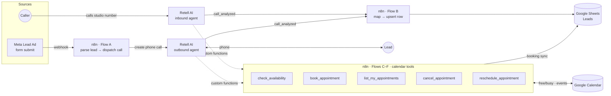

# AI Voice Agent — n8n × Retell AI × Google Calendar × Google Sheets

A Polish-speaking AI receptionist for a fitness studio. It **answers inbound calls 24/7** (books, reschedules and cancels sessions straight in Google Calendar, answers FAQ about hours and prices) and **calls back new Meta Lead Ads leads within seconds**, qualifies them and books a free trial. Every call ends up in Google Sheets with a summary, the full transcript and the recording — no manual data entry.

> 🇵🇱 Asystent głosowy AI dla studia treningowego: odbiera telefony 24/7, umawia, przekłada i odwołuje treningi w Kalendarzu Google, odpowiada na pytania o godziny i ceny, a do nowych leadów z reklam Meta oddzwania w kilka sekund. Każda rozmowa trafia do Arkusza Google z podsumowaniem, transkrypcją i nagraniem.

## What it does

**Inbound — the studio's phone line**
- Greets the caller and handles: free trial booking, rescheduling, cancelling, listing "my appointments", FAQ (hours, prices, location) from a Retell knowledge base.
- Checks real availability (Google Calendar free/busy, studio opening hours and working days) before offering a slot.
- Creates the calendar event with a structured interview note: phone, lead source, training goal, experience level, sessions per week and a call summary.

**Outbound — follow-up of Meta Lead Ads**
- A new lead from a Facebook/Instagram lead form triggers an immediate call from a separate outbound agent ("Paulina").
- She announces that the call is recorded, asks short qualifying questions (experience, sessions per week, preferred day) and books the trial with the same calendar tools.

**After every call**
- Retell's `call_analyzed` webhook writes or updates the lead's row in Google Sheets (keyed by phone number): status, summary, recording URL, transcript, sessions per week, booked date.
- Bookings, cancellations and reschedules made during a call are synced to the same row.

## Architecture



The n8n workflow (`workflows/retell-voice-agent.json`, 75 nodes) exposes 7 webhooks:

| Webhook path | Purpose |
|--------------|---------|
| `meta-lead-inbound` | Flow A — new Meta lead → Retell outbound call |
| `retell-call-analyzed` | Flow B — post-call analysis → Google Sheets |
| `retell-check-availability` | Free slots for a day / time range |
| `retell-book-appointment` | Validate the slot again, create the calendar event |
| `retell-list-appointments` | The caller's upcoming sessions |
| `retell-cancel-appointment` | Find and delete the caller's event |
| `retell-reschedule-appointment` | Find the event, check the new slot, move it |

Every tool validates its input and answers Retell with a short, speakable confirmation or a clear reason why it failed (slot taken, outside opening hours, no booking found…).

## Tech stack

n8n · Retell AI (voice agents, telephony, knowledge base) · Google Calendar API · Google Sheets API · Meta Lead Ads · TypeScript · Node.js test runner · Docker · Cloudflare Tunnel · Hetzner Cloud

## Repository layout

| Path | Purpose |
|------|---------|
| `workflows/retell-voice-agent.json` | **Importable** n8n workflow (all flows). Generated — do not edit by hand |
| `scripts/build-workflow.mjs` | Source of truth for the workflow and its Code nodes; regenerates the JSON |
| `code/*.ts` | Typed, unit-tested logic used by the Code nodes (lead parsing, scheduling, Sheets mapping) |
| `code/tests/`, `scripts/build-workflow.test.mjs`, `scripts/e2e/` | Unit, integration and end-to-end tests |
| `docs/retell-agent-prompt.md` | Inbound agent: voice settings, welcome message, system prompt |
| `docs/retell-outbound-agent-prompt.md` | Outbound agent ("Paulina") prompt |
| `docs/retell-custom-functions.json`, `docs/retell-outbound-custom-functions.json` | Custom function (tool) definitions for both agents |
| `data/faq-pl.json` | FAQ uploaded to the Retell knowledge base |
| `scripts/push-*.mjs`, `scripts/sync-retell-urls.mjs` | Deploy prompts, FAQ and webhook/tool URLs to Retell |
| `scripts/*.ps1` | Windows helpers: Cloudflare tunnel, watchdog, Google Sheets and Retell setup, n8n reload |
| `deploy/hetzner/`, `docs/deploy-hetzner.md` | Production setup: n8n + Cloudflare Tunnel on a Hetzner VPS |

> Files mentioning Vapi or Frappe come from the first prototype of this project (outbound-only, Vapi + Frappe CRM) and are not used by the Retell version.

## Setup

### 1. Google Sheet

1. Create a spreadsheet (e.g. **Voice Leads**) with a tab named **`Leads`** (or set `GOOGLE_SHEETS_SHEET_NAME`).
2. Put this header row in row 1 (columns A–H):

```
phone	full_name	status	call_summary	recording_url	transcript	sessions_per_week	preferred_session_date
```

3. Copy the spreadsheet ID from `https://docs.google.com/spreadsheets/d/<SPREADSHEET_ID>/edit`.

### 2. Environment

```bash
cp .env.example .env    # then fill in your values — never commit .env
```

| Variable | Description |
|----------|-------------|
| `RETELL_API_KEY` | Retell API key |
| `RETELL_INBOUND_AGENT_ID` / `RETELL_OUTBOUND_AGENT_ID` | The two Retell agents |
| `RETELL_FROM_NUMBER` | Studio phone number in E.164 (`+48…`) |
| `PUBLIC_WEBHOOK_URL` | Public URL of n8n (Cloudflare Tunnel or your domain) |
| `GOOGLE_CALENDAR_ID` | Calendar used for bookings (or `primary`) |
| `GOOGLE_SHEETS_DOCUMENT_ID` | Spreadsheet ID |
| `STUDIO_TIMEZONE`, `STUDIO_OPEN_HOUR`, `STUDIO_CLOSE_HOUR`, `STUDIO_WORK_DAYS`, `BOOKING_DURATION_MINUTES` | Opening hours and session length used by the availability checks |

### 3. n8n

n8n → **Workflows → Import from File** → `workflows/retell-voice-agent.json`, then:

1. Create **Google Sheets OAuth2** and **Google Calendar OAuth2** credentials (same Google account) and assign them to the Google nodes.
2. Activate the workflow.

### 4. Retell agents

```bash
node scripts/push-inbound-prompt.mjs       # inbound prompt
node scripts/push-outbound-prompt.mjs      # outbound prompt
node scripts/push-faq-knowledge-base.mjs   # FAQ → knowledge base
node scripts/sync-retell-urls.mjs          # tool URLs, call_analyzed webhook, end_call
```

Assign the studio number to the inbound agent in Retell.

### 5. Try it

```bash
# simulate a Meta lead (places a real outbound call)
curl -X POST "$PUBLIC_WEBHOOK_URL"webhook/meta-lead-inbound \
  -H 'Content-Type: application/json' --data @scripts/test-meta-lead.json
```

Then call the studio number to test the inbound agent. Sample tool payloads for testing the calendar webhooks without a call are in `scripts/test-retell-*.json`.

> Phone numbers without a `+` prefix are treated as Polish (`+48`).

## Development

```bash
cd code && npm install
npm run typecheck
npm test                    # unit tests
npm run test:integration    # workflow build test
cd .. && node scripts/build-workflow.mjs   # regenerate workflows/retell-voice-agent.json
```

## Production

`deploy/hetzner/` runs n8n (bound to `127.0.0.1:5678`) behind a Cloudflare Tunnel on a small Hetzner VPS (~5 €/month). Step-by-step guide: [`docs/deploy-hetzner.md`](docs/deploy-hetzner.md).

## Security

- Secrets live only in `.env` (git-ignored); `.env.example` contains placeholders.
- Editor/AI chat histories (`.specstory/`) and n8n execution dumps are git-ignored — they contain call transcripts, phone numbers and keys.
- Callers are told the call is recorded; transcripts and recordings are stored only in your own Google account.
